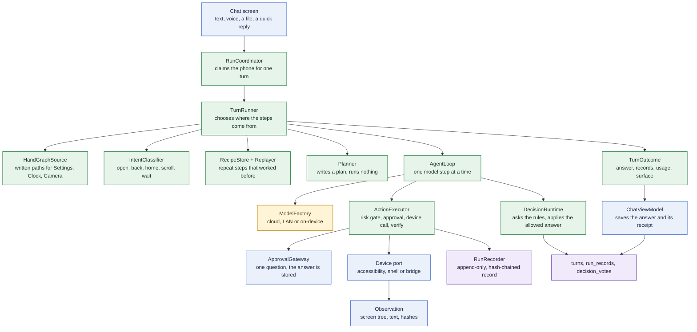
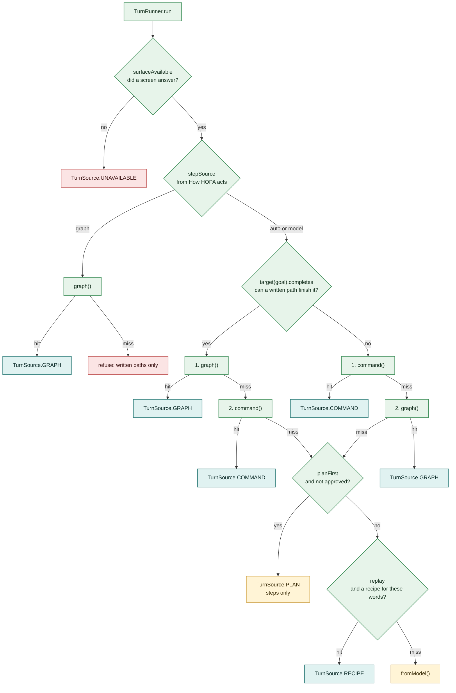
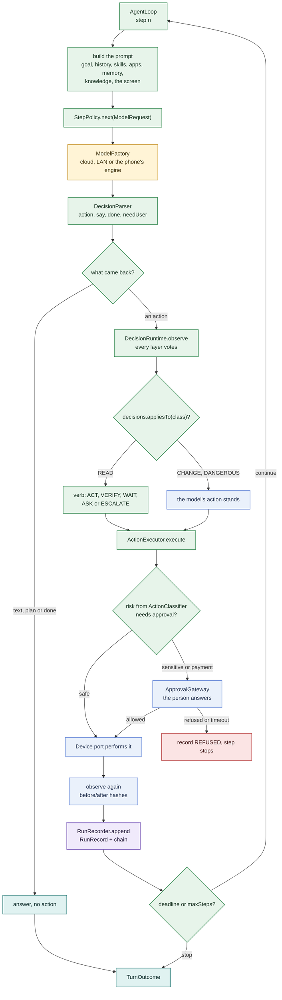
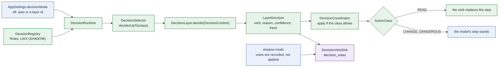
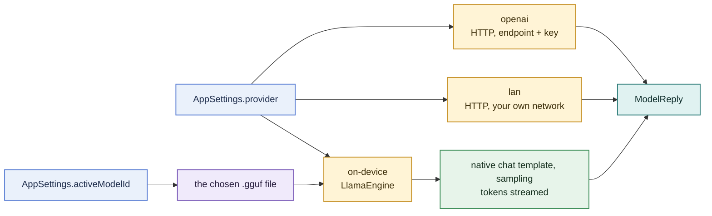

# Architecture of one turn

This page is the architecture of a single turn on the phone: which parts exist,
what each one is responsible for, and in what order they run. It replaces
[`docs/media/hopa-turn-flow.png`](../../media/hopa-turn-flow.png), which predates
on-device models, decision rules and written paths for known apps.

Names in **bold** are the real classes and settings; the sentence after each one
says what it does in plain words.

- **TurnRunner** - tries the places a step can come from, in a fixed order.
- **AgentLoop** - asks the model for one step at a time.
- **ActionExecutor** - checks the step, asks the person when needed, does it and
  verifies the result.
- **DecisionRuntime** - lets the decision rules change a step, within limits.
- A **written path** is a few hand-written steps for an app HOPA knows
  (Settings, Clock, Camera).
- A **token** is the unit a model is paid by; `0 tokens` means no model was
  asked.

The colours mean: blue is input/output, green is HOPA's own code, amber is a
model, purple is storage, red is a refusal.

## The parts of a turn

## The order TurnRunner tries

The order is fixed in `TurnRunner.run`: something already written beats something
generated. The labels name the branch, not the person's feelings.

Two consequences, both visible in the receipt:

- a written path that can finish the goal runs before `command()`, so "open
  camera" ends in `TurnSource.GRAPH`, not `COMMAND`;
- with `stepSource = graph`, neither `command()` nor the model is allowed to
  answer instead.

## One step inside AgentLoop

## Decision layers

`DecisionRuntime` is the only way the loop asks a rule. A layer returns a
`LayerDecision` (verb, reason, confidence, trace, chosen); the runtime applies it
only to actions the layer is allowed to decide, and only to reading steps.

A rule never bypasses `ActionExecutor`: the approval question for a change or a
payment is still asked.

## Where the model comes from

On-device files carry a licence, an exact size and a sha256; the download is
refused without the licence and re-asked when the digest changes. A missing file
is a named error, never a silent cloud fallback.

## What is written down

| Where | What |
|---|---|
| `turns` | the message and `MessageProof`: source, steps, tokens, time, knowledge version |
| `run_records` | one row per executed step, with before/after hashes and a chain |
| `decision_votes` | every layer's opinion per step, including shadow ones |
| `run_history` | the per-turn summary the Activity page reads |

The receipt under an answer is `MessageProof.source`: `graph`, `command`,
`recipe` or `model`. The status line while the turn runs uses the same source, so
a turn cannot claim one thing while running and another in the receipt.

## For developers

| Concern | Code |
|---|---|
| Turn order and the source branches | `core/agent/.../turn/TurnRunner.kt` |
| The step loop, prompt, verification | `core/agent/.../loop/AgentLoop.kt` |
| Decision contract, registry, selector, coordinator | `core/decision/...` |
| Rules, LAIX, commands, written paths | `core/decision/.../{rules,laix,classifier,graph}` |
| Executor, gate, approval | `core/agent/.../action/ActionExecutor.kt`, `apps/android/.../UiApprovalGateway.kt` |
| Model choice and the on-device engine | `apps/android/app/.../di/AppContainer.kt`, `core/inference/...` |
| Receipt and live label | `apps/android/feature/chat/.../ChatViewModel.kt` |
| One turn at a time | `core/runtime/.../RunGate.kt` |
