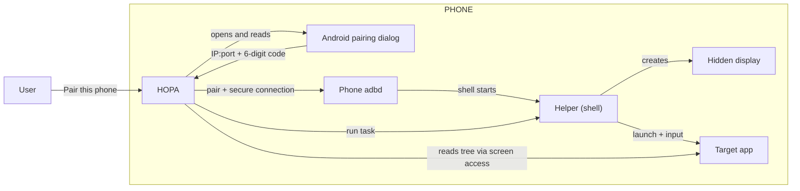
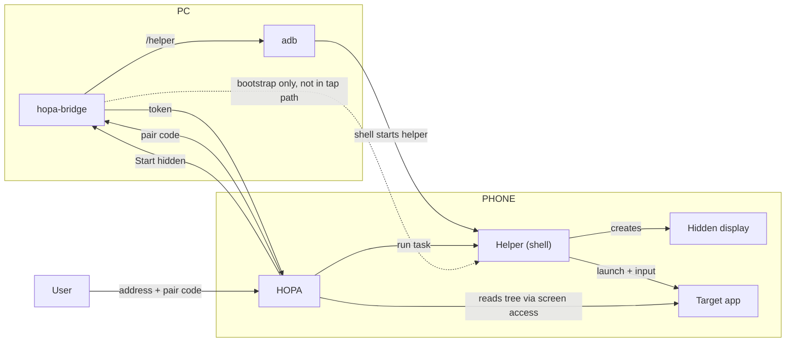
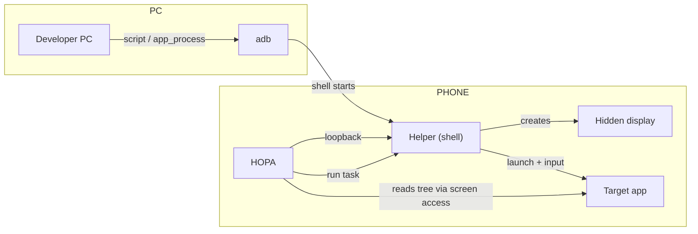
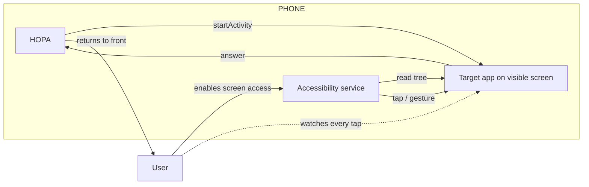
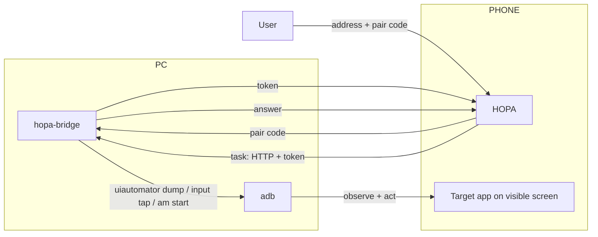
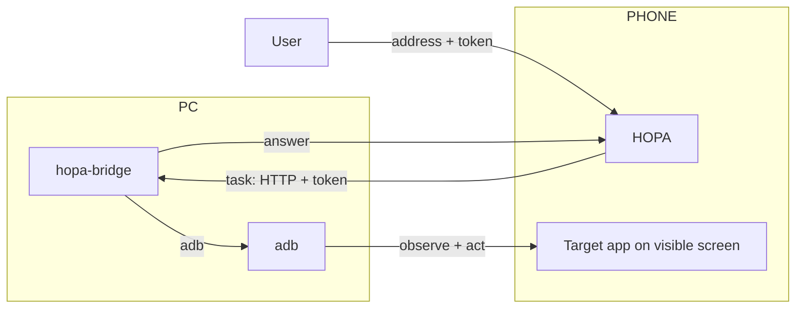
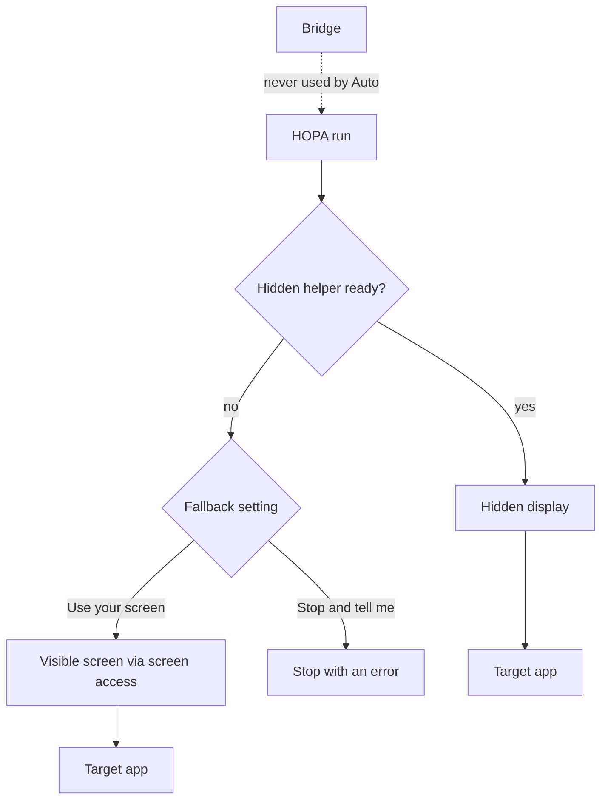

# Run modes and setup paths

This page describes seven ways to make HOPA act on an app. Each section is
self-contained: it repeats the words, prerequisites and steps it needs, so you
can read only the section you are setting up.

The seven paths are:

1. [Hidden screen, started with Wireless debugging](#1-hidden-screen-started-with-wireless-debugging)
2. [Hidden screen, started by the PC bridge](#2-hidden-screen-started-by-the-pc-bridge)
3. [Hidden screen, started with manual adb](#3-hidden-screen-started-with-manual-adb)
4. [Your screen](#4-your-screen)
5. [Bridge with a pair code](#5-bridge-with-a-pair-code)
6. [Bridge with a token](#6-bridge-with-a-token)
7. [Auto: hidden screen, then your screen](#7-auto-hidden-screen-then-your-screen)

Two things are not separate modes:

- **"Helper already running"** is not a mode. It is the state after one of the
  three Hidden screen starts below.
- **A pair code or a token** is how the bridge is authorised. It is not a
  different place for the app to open.

---

## 1. Hidden screen, started with Wireless debugging

### What this is

The app opens on a virtual display inside the phone. You cannot see that
display. HOPA stays on the screen you are looking at, and the app's audio is
muted for the run.

No PC is needed. The phone's own Wireless debugging gives HOPA shell access,
and HOPA uses that shell to start its helper. The helper creates the virtual
display.



**Words used here**

- **Screen access** — HOPA's permission to read the screen and tap. It has two
  parts: Android's Accessibility service, and HOPA's own switch **Let HOPA see
  and tap**.
- **Helper** — a small shell process on the phone. It creates the hidden
  display, launches apps on it and sends taps to it.
- **Hidden display** — the virtual display you cannot see.
- **Wireless debugging** — an Android Developer option that lets a device
  connect to the phone's own adb daemon over Wi-Fi.
- **Pairing dialog** — Android's **Pair device with pairing code** dialog. It
  shows an IP address, a port and a six-digit code.
- **PC bridge** — `hopa-bridge` on a PC, connected to the phone over adb. It is
  only a fallback here if wireless pairing fails.
- **adb** — Android Debug Bridge, the PC tool the bridge uses.

### What you need

- The phone connected to Wi-Fi.
- Developer options enabled on the phone.
- Screen access on, both in Android and inside HOPA.
- The phone unlocked while you pair.

### Steps

1. **Enable Developer options if it is not already enabled.**
   Open **Settings → About phone → Software information**. Tap **Build number**
   seven times. Enter the phone PIN if Android asks.
2. **Turn on screen access.**
   Open HOPA → **Act** → **Setup & test** → **Screen access**. Turn on
   **Let HOPA see and tap**.
   If the Android service is off, tap **Open Android settings**, open
   **Accessibility**, find **HOPA** and turn it on. On Samsung the path can be
   **Settings → Accessibility → Installed apps → HOPA**.
3. **Connect the phone to Wi-Fi.**
4. **Open the hidden-screen setup.**
   HOPA → **Act** → **How HOPA acts** → **This phone** → **Hidden screen** →
   **Set up the hidden screen**.
5. **Tap `Pair this phone`.**
6. **Watch the Android settings pages.**
   HOPA opens **Settings → Developer options → Wireless debugging**.
   If the **Wireless debugging** switch is off, turn it on yourself; HOPA does
   not flip that switch.
   HOPA then presses **Pair device with pairing code**.
7. **Keep the pairing dialog open.**
   It shows an IP address and port (for example `192.168.1.5:37123`) and a
   six-digit code. Do not switch apps while it is open.
   A HOPA notification called **Pairing with Android** appears.
8. **Wait for HOPA to read the code and pair.**
   HOPA reads the address and code through screen access, pairs with the
   phone's adb daemon, connects securely and starts the helper.
9. **Wait for the result.**
   HOPA returns to the app and shows **Wireless shell is ready; the hidden
   screen can be used** or **Hidden screen is ready**.

After a successful pairing the helper is already running. You do **not** need
a separate **Start** button. The hidden display itself is created when a task
runs, and it is closed when the task ends.

### How to check it

- Open **Act → Setup & test**. The **Hidden screen** row should say **Running**.
- Tap **Check that it works**. A green line says **Tested it: Settings opened
  out of sight**.
- Ask HOPA to open an app. The app should not appear on your visible screen.

### If it does not work

- If HOPA says **Turn on screen access first**, fix step 2 above.
- If HOPA cannot find Wireless debugging, make sure Developer options are
  enabled and the phone is on Wi-Fi.
- If HOPA cannot press the pairing row, use the **I'll open the dialog myself**
  button instead:
  1. Tap it in HOPA.
  2. Open **Settings → Developer options → Wireless debugging** yourself.
  3. Turn Wireless debugging on.
  4. Tap **Pair device with pairing code**.
  5. Leave that dialog open. HOPA waits up to 120 seconds, reads the code and
     pairs from the background.
- The **Address** and **Six digits** fields in the setup dialog are a fallback.
  On Android 17 the pairing port can close as soon as the dialog loses focus,
  so typing the code in HOPA after switching away may fail. Prefer
  **Pair this phone** or **I'll open the dialog myself**.
- If Android blocks the Accessibility service for a sideloaded app, open
  **Settings → Apps → HOPA → three-dot menu → Allow restricted settings**. On
  Samsung, if the item is missing, turn off **Auto Blocker** under **Security
  and privacy**, repeat the step, then turn it back on.
- If pairing still fails, use a PC bridge instead: run `hopa-bridge` on the
  PC, pair it on the phone, then start the hidden screen from the phone.

### After a reboot or force-stop

The helper process stops. Turn Wireless debugging on and start a task; HOPA
reconnects with the stored key and starts the helper again. If it cannot
reconnect, open **Setup & test → Hidden screen** and pair again.

### To re-pair or change the connection

Open **Act → Setup & test → Hidden screen**. When the row says **Running**, tap
it, then choose **Re-pair**. The hidden-screen setup dialog opens again.

---

## 2. Hidden screen, started by the PC bridge

### What this is

The app opens on a virtual display inside the phone. You cannot see that
display; HOPA stays on your visible screen, and the app's audio is muted for
the run. A PC bridge starts the helper over adb. Once the helper is running,
the PC is **not** in the tap path. The app still runs on the phone's hidden
display, and the phone talks to the helper on loopback (`127.0.0.1` inside the
phone).



**Words used here**

- **Screen access** — HOPA's permission to read the screen and tap. It needs
  Android's Accessibility service plus HOPA's **Let HOPA see and tap** switch.
- **Bridge** — the `hopa-bridge` program running on a PC. It talks to the
  phone over adb.
- **adb** — Android Debug Bridge. The PC uses it to reach the phone.
- **Helper** — the shell process on the phone that creates the hidden display.
- **Pair code** — the six-digit code printed by the bridge. The phone uses it
  once to get a token.
- **Token** — the secret stored on the phone after pairing. It authorises
  later requests to the bridge.

### What you need

- A PC with `hopa-bridge` installed and `adb` working.
- The phone connected to that PC by USB or wireless adb. `adb devices` on the
  PC must list the phone.
- The PC and the phone able to reach each other. For the first pairing, the
  bridge must be reachable from the phone on your local network.
- Screen access on, both in Android and inside HOPA.
- The bridge pair code from the PC console.

### Steps

1. **Start the bridge on the PC.**
   In a terminal on the PC, run:

   ```
   hopa-bridge --platform android bridge --host 0.0.0.0 --port 8765
   ```

   Keep this terminal open. The bridge prints a line like:

   ```
   bridge listening on http://0.0.0.0:8765
   token: ...
   pair code: 123456
   ```

   Use the PC's local network address on the phone, for example
   `http://192.168.1.5:8765`. If Windows Firewall asks, allow the port.
2. **Pair the phone with the bridge.**
   On the phone: HOPA → **Act** → **How HOPA acts** → **My computer**.
   Enter the address (`http://<PC-IP>:8765`) and the pair code printed by
   the bridge. Tap **Pair**.
3. **Start the hidden helper.**
   On the phone: HOPA → **Act** → **How HOPA acts** → **This phone** →
   **Hidden screen** → **Start the hidden screen**.
   If the button says **Set up the hidden screen**, the bridge is not paired or
   the app cannot see the token; pair it again in **My computer**.
4. **Wait for the helper.**
   HOPA sends `/helper` to the bridge. The bridge runs the helper as shell on
   the phone. Wait for **Hidden screen is ready** or look at
   **Setup & test → Hidden screen → Running**.

After the helper starts, the PC is no longer needed for taps. The phone talks
to the helper on loopback. If the PC is turned off or the network drops, the
hidden run can still continue until the helper stops. If the helper stops or
the phone reboots, start it again from the phone (the bridge must be running
again for that start).

### How to check it

- **Act → Setup & test → Hidden screen** says **Running**.
- **Check that it works** shows **Tested it: Settings opened out of sight**.
- The app opens off-screen; your visible screen stays on HOPA.

### If it does not work

- Run `adb devices` on the PC. If the phone is not listed, fix USB debugging
  or wireless adb first.
- Make sure the bridge is still running and the phone can reach the PC's
  local network address and port.
- Check the pair code and the token in **My computer**.
- Make sure screen access is on. The hidden display needs it to read the app.
- If **Start the hidden screen** does not appear, pair the bridge again in
  **My computer**, then return to **Hidden screen**.
- If the helper starts but does not answer, start it with phone-only Wireless
  debugging, or with a manual adb script from a developer PC.

### To re-pair or change the connection

Open **Act → Setup & test → Hidden screen**. If it says **Running**, tap it and
choose **Re-pair**. For the bridge itself, open **Act → How HOPA acts → My
computer** and pair again.

---

## 3. Hidden screen, started with manual adb

### What this is

The app opens on a virtual display inside the phone. You cannot see it; HOPA
stays on your visible screen, and the app's audio is muted for the run. A
developer starts the helper from a PC with adb. There is no button in the app
for this path.

Use it only for development, debugging or recovery. Normal users should use
the wireless or PC-bridge start.



**Words used here**

- **Screen access** — Android Accessibility plus HOPA's **Let HOPA see and
  tap** switch.
- **adb** — Android Debug Bridge on the PC.
- **Helper** — the shell process on the phone that creates the hidden display.
- **ShellMain** — the helper's main class. It runs as the shell user.
- **APK** — the HOPA app package installed on the phone.
- **Loopback** — the phone's own `127.0.0.1` address. The app uses it to reach
  the helper.

### What you need

- A PC with adb and the HOPA repository tools.
- USB debugging enabled on the phone and the phone authorised for the PC.
- Screen access on in Android and in HOPA.
- The APK installed on the phone.

### Steps

1. **Enable USB debugging.**
   Phone: **Settings → About phone → Software information**, tap **Build
   number** seven times if Developer options is not enabled. Then open
   **Settings → Developer options → USB debugging** and turn it on.
2. **Connect the phone and authorise the PC.**
   Connect USB. On the phone, accept **Allow USB debugging** for this PC.
3. **Check adb.**
   On the PC:

   ```
   adb devices
   ```

   The phone must be listed as `device`, not `unauthorized`.
4. **Start the helper.**
   From the HOPA repository on the PC, run the device helper script:

   ```
   powershell -ExecutionPolicy Bypass -File tools\scripts\android-device-checks.ps1
   ```

   On macOS/Linux, use the equivalent script that pushes and runs
   `/data/local/tmp/hopa_display.sh`. The script starts `ShellMain` as shell.
   This is a developer path; the exact paths can change between APKs.
5. **Check the phone.**
   Open HOPA → **Act → Setup & test**. **Hidden screen** should say
   **Running**.
6. **Run a task.**
   Ask HOPA to open an app. It should open on the hidden display.

### How to check it

- **Setup & test → Hidden screen → Running**.
- **Check that it works → Tested it: Settings opened out of sight**.
- Your visible screen stays on HOPA.

### If it does not work

- Run `adb devices` and fix `unauthorized` or missing devices.
- Make sure screen access is on; the hidden display still uses the
  accessibility tree.
- Make sure the script and the APK match. A helper from an older APK can fail
  to start.
- Check that the phone is not blocking shell access or the helper port.
- This path is not supported from the app UI; if it keeps failing, use the
  wireless or PC-bridge start.

---

## 4. Your screen

### What this is

HOPA opens the app on the phone's normal visible screen. You watch every tap.
HOPA reads the screen through Android's Accessibility service and performs
taps and gestures. After the run, HOPA comes back to the front.

No helper and no PC are involved.



**Words used here**

- **Screen access** — Android's Accessibility service for HOPA, plus HOPA's
  own **Let HOPA see and tap** switch.
- **Accessibility service** — Android's API that lets HOPA read the screen
  tree and perform actions.

### What you need

- Android Accessibility service enabled for HOPA.
- HOPA's **Let HOPA see and tap** switch on.
- The phone unlocked.

### Steps

1. Open HOPA → **Act** → **Setup & test** → **Screen access**.
2. Turn on **Let HOPA see and tap**.
3. If **Android service** says **Off**, tap **Open Android settings**, open
   **Accessibility**, find **HOPA** and turn it on. On Samsung the path can be
   **Settings → Accessibility → Installed apps → HOPA**.
4. Return to HOPA. The **Screen access** page should show **On**, with
   **Android service On** and **Connection Live**.
5. Open HOPA → **Act** → **How HOPA acts** → **This phone** → **Your screen**.
6. Ask HOPA to do something. The target app opens over HOPA. You see the taps.
   HOPA returns when the run ends.

### How to check it

- **Act → How HOPA acts → This phone → Your screen** shows **Screen access is
  on. You watch every tap.**
- **Act → Setup & test → Check that it works** shows **HOPA can see your
  screen**.

### If it does not work

- **Paused by you** means Android still has the service on, but HOPA's own
  switch is off. Turn on **Let HOPA see and tap**.
- **Off** means Android's Accessibility service is off. Use **Open Android
  settings** and turn HOPA on.
- **Connecting** means the service is on but not bound yet. Wait a moment; if
  it stays like that, turn the switch off and on, or restart the phone.
- Samsung can reset Accessibility after reinstalling or force-stopping HOPA.
  Turn the service back on.
- For a sideloaded app, allow restricted settings:
  **Settings → Apps → HOPA → three-dot menu → Allow restricted settings**.
  On Samsung, **Auto Blocker** under **Security and privacy** can block it.
- No helper or PC is needed, so do not look for a bridge or hidden-screen
  setting on this path.

---

## 5. Bridge with a pair code

### What this is

A bridge program runs on a PC. It controls this phone's **visible** screen over
adb. The app still runs on the phone, but every observation, tap, launch and
screenshot goes through the PC.

The PC is in the loop for the whole run. If the PC sleeps, closes the terminal
or loses the network, the run fails.

Screen access is **not** needed for this mode: the bridge reads the screen with
`uiautomator` and taps with adb.



**Words used here**

- **Bridge** — the `hopa-bridge` program on the PC.
- **adb** — Android Debug Bridge. The bridge uses it to reach the phone.
- **Pair code** — the six-digit code printed by the bridge. It is used once to
  get a token.
- **Token** — the secret the phone stores after pairing. It authorises later
  requests to the bridge.
- **Screen access** — Android's Accessibility service plus HOPA's **Let HOPA
  see and tap** switch. This mode does not need it.
- **uiautomator** — Android's UI dump tool. The bridge uses it to read the
  phone's screen over adb.

### What you need

- A PC with `hopa-bridge` installed and `adb` working.
- The phone connected to the PC by USB or wireless adb. `adb devices` on the
  PC must list the phone.
- The phone and PC on the same network, with the bridge port reachable.
- The bridge pair code.

### Steps

1. **Start the bridge on the PC.**
   In a terminal on the PC, run:

   ```
   hopa-bridge --platform android bridge --host 0.0.0.0 --port 8765
   ```

   Keep the terminal open. Note the address and pair code. The bridge prints
   something like:

   ```
   bridge listening on http://0.0.0.0:8765
   token: ...
   pair code: 123456
   ```

   On the phone use `http://<PC-IP>:8765`, not `0.0.0.0`.
2. **Check adb on the PC.**

   ```
   adb devices
   ```

   The phone must be listed as `device`.
3. **Pair on the phone.**
   HOPA → **Act** → **How HOPA acts** → **My computer**.
   Enter the address (`http://<PC-IP>:8765`) and the pair code. Tap
   **Pair**.
4. **Choose the bridge mode on the phone.**
   Stay on **How HOPA acts** and choose **My computer** under **Who taps**.
5. **Ask HOPA to do something.**
   The phone sends the request to the bridge. The bridge uses adb to observe
   and act on the phone's visible screen. The app opens visibly.

### How to check it

- **Act → How HOPA acts → My computer** says **HOPA bridge is ready.**
- Tap **Test bridge**. A success message starts with **Bridge ok**.
- **Act → Setup & test → Bridge** says **Paired**.

### If it does not work

- The PC must stay on and the terminal must stay open.
- Run `adb devices` again. Fix USB debugging or wireless adb if the phone is
  missing or `unauthorized`.
- Check that the phone can reach the PC's local network IP and port. Windows Firewall
  may block the port.
- Make sure the phone and PC are on the same network. `127.0.0.1` on the PC is
  not reachable from the phone.
- Check the pair code. If the bridge was restarted without saved state, pair
  again.
- If the bridge is paired but the run fails, open **My computer** and use
  **Test bridge** to see whether the PC can still read the phone.
- Screen access is not the problem here. The bridge does not need it.

---

## 6. Bridge with a token

### What this is

A bridge program on a PC controls this phone's visible screen over adb. The app
runs on the phone, but every observation, tap, launch and screenshot goes
through the PC. The PC is in the loop for the whole run.

Use this when you already have a token, when you set a known token with
`--token`, or when an automation tool gives you one.

The phone is authorised with a token instead of a six-digit pair code.
Screen access is not needed for this mode.



**Words used here**

- **Bridge** — the `hopa-bridge` program on the PC.
- **adb** — Android Debug Bridge.
- **Token** — the secret string printed by the bridge or set with `--token`.
  It authorises requests to the bridge.
- **TTL** — how long the token stays valid.
- **Screen access** — Android's Accessibility service plus HOPA's **Let HOPA
  see and tap** switch. This mode does not need it.

### What you need

- A PC with `hopa-bridge` installed and `adb` working.
- The phone connected to the PC by USB or wireless adb, listed by
  `adb devices`.
- The phone and PC on the same network, with the bridge port reachable.
- A valid bridge token.

### Steps

1. **Start the bridge on the PC.**
   Either use the token the bridge prints:

   ```
   hopa-bridge --platform android bridge --host 0.0.0.0 --port 8765
   ```

   or set your own:

   ```
   hopa-bridge --platform android bridge --host 0.0.0.0 --port 8765 --token YOUR_SECRET
   ```

   Keep the terminal open. Note the address and token.
2. **Check adb.**

   ```
   adb devices
   ```

   The phone must be listed as `device`.
3. **Enter the token on the phone.**
   HOPA → **Act** → **How HOPA acts** → **My computer**.
   Enter the address (`http://<PC-IP>:8765`).
   Tap **I have a token instead**, enter the token, then tap **Use this token**.
4. **Choose the bridge mode on the phone.**
   Choose **My computer** under **Who taps**.
5. **Ask HOPA to do something.**
   The phone sends the request to the bridge. The PC drives the phone's
   visible screen over adb.

### How to check it

- **Act → How HOPA acts → My computer** says **HOPA bridge is ready.**
- **Test bridge** returns **Bridge ok**.
- **Act → Setup & test → Bridge** says **Paired**.

### If it does not work

- Check that the token is exactly the one printed by the bridge, including
  case and punctuation.
- If the token has expired, restart the bridge or start it with a longer
  `--token-ttl-hours`. Then enter the new token.
- Run `adb devices` and fix a missing or `unauthorized` phone.
- Check the local network address and port; `127.0.0.1` is not reachable from the phone.
- Allow the bridge port through Windows Firewall.
- Keep the PC awake. A sleeping PC breaks the run.
- Screen access is not required. Do not turn it on just for this mode.

---

## 7. Auto: hidden screen, then your screen

### What this is

Auto is a **policy**, not a fourth place. It means: try the hidden screen
first, and if the hidden screen cannot start, use your visible screen instead.
It never uses the bridge.

In the app, Auto is the pair of choices **Hidden screen** plus **Use your
screen** under **If the hidden screen can't start**. If you change that to
**Stop and tell me**, it is no longer Auto; it is strict hidden mode.



**Words used here**

- **Hidden screen** — a virtual display inside the phone that you cannot see.
- **Helper** — the shell process that creates the hidden display.
- **Your screen** — the phone's normal visible screen.
- **Screen access** — Android's Accessibility service for HOPA plus HOPA's
  **Let HOPA see and tap** switch. It is needed for the visible fallback and
  also for reading the hidden display.
- **Bridge** — a PC program that can drive the phone's visible screen over
  adb. Auto never uses it.
- **adb** — Android Debug Bridge, a developer tool on a PC.
- **Pair code** — the six-digit code printed by the bridge. It is used only if
  you choose the PC-bridge way to start the hidden screen.

### What you need

- Screen access on, both in Android and in HOPA, if you want the visible
  fallback to work.
- A hidden screen that is already set up if you want the first choice to work.
  To set it up, choose one:
  - **Wireless debugging:** HOPA → **Act → How HOPA acts → This phone →
    Hidden screen → Set up the hidden screen → Pair this phone**. Keep
    Android's pairing dialog open while HOPA reads it.
  - **PC bridge start:** pair the bridge in **My computer**, then open
    **Hidden screen** and tap **Start the hidden screen**.
  - **Manual adb:** start the helper with the developer script. This is a
    developer path.

### Steps

1. **Turn on screen access.**
   HOPA → **Act → Setup & test → Screen access**. Turn on **Let HOPA see and
   tap**. If the Android service is off, tap **Open Android settings** and
   turn on HOPA under **Accessibility**.
2. **Open the phone mode.**
   HOPA → **Act → How HOPA acts → This phone → Hidden screen**.
3. **Check the fallback choice.**
   Under **If the hidden screen can't start**, choose **Use your screen**.
   This is Auto. **Stop and tell me** means no fallback.
4. **Make sure the hidden screen is available if you want it.**
   If the card says **Hidden screen is ready**, Auto will use it. If it says
   it is not running and the fallback is on, Auto will use your screen.
5. **Ask HOPA to do something.**
   HOPA tries the hidden screen first. If it cannot start or read it, and the
   fallback is **Use your screen**, HOPA uses the visible screen. If the
   fallback is **Stop and tell me**, the run stops with an error.

### How to check it

- If the hidden screen is ready, the Act hub says **This phone · Hidden
  screen** and the run uses the hidden display.
- If the hidden screen is not ready and fallback is on, the hub can say
  **This phone · Your screen** with a note that the hidden screen is not
  ready.
- **Act → Setup & test → Check that it works** shows the current mode and
  whether hidden or screen access is ready.
- The phone's **Your screen** status should say **Screen access is on**.

### If it does not work

- If both hidden and visible fail, screen access is probably off. Turn it on
  in **Setup & test → Screen access**.
- If hidden is expected but the run uses your screen, the helper is not
  running or cannot be read. Start it with the wireless, PC-bridge or manual
  path, or accept the visible fallback.
- If **Stop and tell me** is selected, there is no fallback. The run will stop
  when hidden cannot start; choose **Use your screen** to allow the fallback.
- Auto never uses the bridge. If you want the bridge, choose **My computer**
  under **Who taps** instead.
