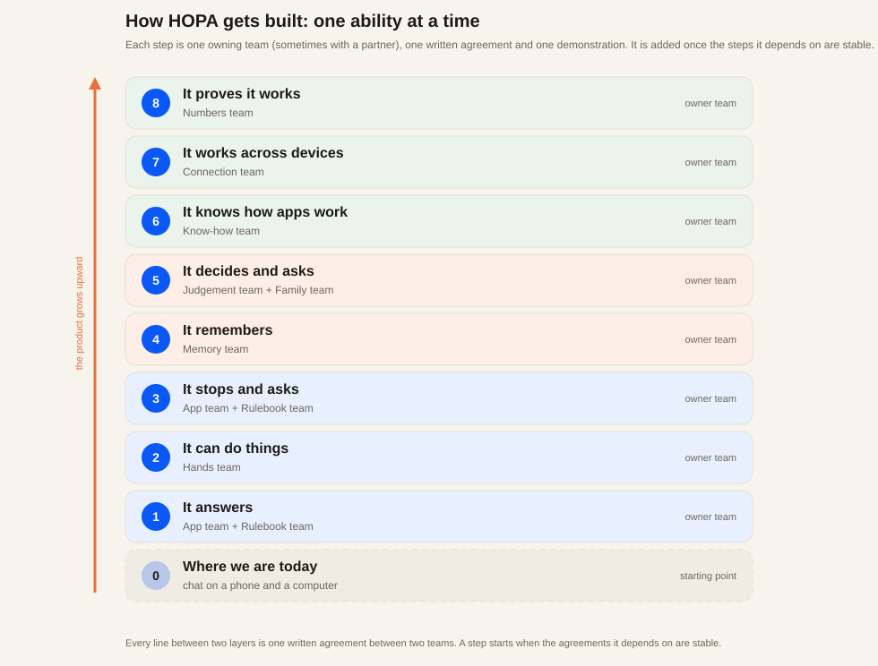

# How HOPA gets built, one team at a time

For product managers and anyone meeting the product and the teams for the first
time. Plain language, with a folder name wherever it helps an engineer.

**The idea in one sentence:** we build HOPA one ability at a time. Each step adds
one ability, has one owning team (sometimes with a partner), and ends with
something you can watch.

The document builds the product from the ground up. Each step is added once the
steps it depends on are stable, and the whole picture appears at the end.

## How to read a step

Every step has the same shape, so the reading does not change when the team does.

```
   +-------------------------------------------------------------+
   |  TEAM        the owning team, and the partner if there is one|
   |  BUILDS      the part itself, in plain words                 |
   |  JOINS       what it plugs into, and the written agreement   |
   |  LIVES IN    the folder or service, for the engineers        |
   |  YOU SEE     the demonstration; if it does not work, not done|
   +-------------------------------------------------------------+
```

The "written agreement" is one page: what I hand over, in what shape, and how
you can tell it works. It is how two teams avoid building two products.

```
   one team                          the next team
  +---------+      one page        +---------+
  |  builds | -------------------> |  builds |
  +---------+   "what I hand over  +---------+
                 and how it works"
```

## The cast

You will meet these teams in the steps below. Nothing else about them is needed
to follow the story.

| Team | In one sentence |
|---|---|
| App team | "We make the part a person touches, and it works on both devices." |
| Rulebook team | "We keep the shared words and the safety rules, so the parts fit." |
| Hands team | "We do one thing on a real device and prove it happened." |
| Memory team | "We make sure a request is never lost and can continue anywhere." |
| Judgement team | "We decide what to do next, with a reason." |
| Family team | "We decide who is asked, how often, and what was promised." |
| Know-how team | "We know how each app works, and we keep it working after updates." |
| Connection team | "We connect devices and keep them connected safely." |
| Numbers team | "We tell everyone what to fix first, with numbers." |

## Where we are today

HOPA runs on a phone and on a computer: you can type a question, get an answer,
and open the app again with your conversations still there. It can also do a few
things on a device in a demonstration, but none of that is finished or safe
enough to promise. That is the ground floor.

## The route

The steps below climb this ladder. Read the ladder as a map, not as a summary:
each rung is explained in its own step.

```
8  It proves it works          Numbers team
7  It works across devices     Connection team
6  It knows how apps work      Know-how team
5  It decides and asks         Judgement team + Family team
4  It remembers                Memory team
3  It stops and asks           App team + Rulebook team
2  It can do things            Hands team
1  It answers                  App team + Rulebook team
0  It runs on two devices      what we have today
```

---

## Step 1 - It answers

**Team:** App team, with the Rulebook team.

**What they build:** the screen a person touches on both devices - chat, writing
box, history, settings - and the shared rulebook (contracts, CI, release) that
every later team will use.

**How it joins:** it is the front door. Everything else plugs in here.

**Lives in:** `apps/android`, `apps/windows`, `packages/`, `contracts/`.

```
  +--------------------------------------+
  | 1  It answers                        |  App team
  +--------------------------------------+
       the front door: every later part plugs in here
```

**What you can see:** type "hello", get an answer, close the app, open it again.

## Step 2 - It can do things

**Team:** Hands team.

**What they build:** the part that touches a device - taps a button, types text,
opens an app - and checks afterwards that it really happened. It works on the
phone and on the computer, and says plainly when it cannot (a locked screen, a
window the system protects).

**How it joins:** the app asks for one step; the step comes back with proof.

**Lives in:** `packages/capabilities` (the bridge client), `services/bridge`
(the PC side), `apps/windows/.../WindowsDevice.cs` (the PC adapter).

```
  +--------------------------------------+
  | 2  It can do things                  |  Hands team  (new)
  +------------------+-------------------+
                     | plugs into
  +------------------v-------------------+
  | 1  It answers                        |  App team
  +--------------------------------------+
```

**What you can see:** from the computer, "open Settings on the phone" - the phone
changes. In a text editor, "type this" - the words appear and are read back.

## Step 3 - It stops and asks

**Team:** App team, with the Rulebook team.

**What they build:** the safety rules. Before anything important - money, deleting,
sending a message as someone else - HOPA stops and asks. Every step goes into a
receipt book that cannot be quietly edited.

**How it joins:** everything that reaches a device now passes the rules first.

**Lives in:** `packages/core` (the gate and the records), `contracts/policy`.

```
  +--------------------------------------+
  | 3  It stops and asks                 |  App team + Rulebook (new)
  +------------------+-------------------+
                     | plugs into
  +------------------v-------------------+
  | 2  It can do things                  |  Hands team
  +--------------------------------------+
```

**What you can see:** a payment stops and asks; saying no means nothing happens;
editing a receipt makes the check fail; a Stop button ends a long job.

## Step 4 - It remembers

**Team:** Memory team.

**What they build:** the to-do list behind the chat. A request gets a state, an
owner, a due time and a place to continue - including on another device. A
notification can become a to-do.

**How it joins:** the app shows the list; safety and hands work on one item at a
time.

**Lives in:** `contracts/tasks`, `services/tasks` (new).

```
  +--------------------------------------+
  | 4  It remembers                      |  Memory team  (new)
  +------------------+-------------------+
                     | plugs into
  +------------------v-------------------+
  | 3  It stops and asks                 |  App team + Rulebook
  +--------------------------------------+
```

**What you can see:** start something on the phone, close everything, continue on
the computer. A notification turns into a to-do with a date and an owner.

## Step 5 - It decides and asks the right person

**Team:** Judgement team and Family team, together.

**What they build:** the thinking between "what was asked" and "what to do" -
wait, look again, tell the person, ask, do it, check it, or hand it to a person -
always with a reason. Plus the family rules: who may approve what, which promises
are still open, and how many interruptions a person can take today.

**How it joins:** the safety rules ask this part what to do instead of using one
fixed rule; the to-do list carries the promises.

**Lives in:** `packages/decision` (new, from LAIX), `contracts/decision`,
`contracts/family`.

```
  +--------------------------------------+
  | 5  It decides and asks               |  Judgement + Family (new)
  +------------------+-------------------+
                     | plugs into
  +------------------v-------------------+
  | 4  It remembers                      |  Memory team
  +--------------------------------------+
```

**What you can see:** a payment asks exactly the right person, once, and stops if
they say no; a promise made on Monday changes Tuesday's decision; a child's
request waits for a parent; HOPA does not nag five times.

## Step 6 - It knows how apps work

**Team:** Know-how team.

**What they build:** a library of step-by-step instructions per app ("open the
bank, go to Payments, choose Internet, enter the amount, confirm") with the check
that says it worked. Instructions are written once, reviewed, signed and shipped
to all devices. When an app updates and a step breaks, the team's rack of test
phones catches it and the previous working version is put back.

**How it joins:** the hands part follows the instructions; the to-do list asks
for the right one.

**Lives in:** `contracts/recipes`, `services/mapping` (new), the test rack.

```
  +--------------------------------------+
  | 6  It knows how apps work            |  Know-how team  (new)
  +------------------+-------------------+
                     | plugs into
  +------------------v-------------------+
  | 5  It decides and asks               |  Judgement + Family
  +--------------------------------------+
```

**What you can see:** a new app is supported in a day. An update breaks a step;
the test rack notices and the old version returns before anyone complains.

## Step 7 - It works across devices

**Team:** Connection team.

**What they build:** the link between phone and computer: pairing with a short
code, safe keys that renew themselves, and the choice of which device does the
work.

**How it joins:** it sits under every step that crosses from one device to
another. It carries messages; it does not decide anything. The picture shows the
first step it carries; it also carries Steps 4 and 5.

**Lives in:** `services/bridge`, `services/relay`, `services/wire`.

```
  +--------------------------------------+
  | 7  It works across devices           |  Connection team  (new)
  +------------------+-------------------+
                     | sits under
  +------------------v-------------------+
  | 2  It can do things (on the phone)    |  Hands team
  +--------------------------------------+
```

**What you can see:** pair a new phone with a code in a minute; a key renews
itself mid-job and the work continues.

## Step 8 - It proves it works

**Team:** Numbers team.

**What they build:** the measuring stick: what succeeded, for whom, how long it
took, how often a person had to repeat themselves, and what is most worth fixing
next. It changes nothing itself; it decides what changes next.

**How it joins:** it reads the receipt books from Step 3 and the results of every
other step.

**Lives in:** `services/evals`.

```
  +--------------------------------------+
  | 8  It proves it works                |  Numbers team  (new)
  +------------------+-------------------+
                     | reads the receipts
  +------------------v-------------------+
  | 3  It stops and asks                 |  App team + Rulebook
  +--------------------------------------+
```

**What you can see:** one page of numbers that ranks the next three fixes, and a
test that fails when a safety rule gets weaker.

---

## The whole picture

Eight steps later, this is the product. Every line between two layers is one
written agreement between two teams.



## When a step can start

A step does not wait for the step below to be perfect. It starts when the written
agreement it depends on is stable: the shape is fixed, the other team can rely
on it, and a failure is visible.

That is why the steps overlap in time. The schedule below is not "finish, then
start"; it is "stabilise the agreement, then start".

## When each team joins

```
weeks        0     4     8     12    16    20    24
             |     |     |     |     |     |     |
Step 1       ====
Step 2         ======
Step 3         ======
Step 4               ======
Step 5               ======
Step 6                     ========
Step 7             ========
Step 8                           ==============
```

| Weeks | Steps being built | Teams joining |
|---|---|---|
| 0 | 1 | App team, Rulebook team |
| 1-4 | 1-3 | Hands team |
| 4-10 | 4-5 | Memory team, Judgement team, Family team |
| 6-14 | 7 | Connection team (works in parallel) |
| 8-16 | 6 | Know-how team |
| 10 onwards | 8 | Numbers team (from the moment there are receipts) |

## Small glossary

Only six words from the "Lives in" lines; everything else is spelled out above.

| Word | What it means here |
|---|---|
| **package** | code shared by both clients, so the phone and the computer behave the same |
| **service** | a part that runs on a computer or server, never on the phone |
| **bridge** | the link that lets the computer (or the cloud) reach the phone |
| **contract** | the written agreement between two teams: what is handed over and how it is checked |
| **recipe** | step-by-step instructions for one app, with the check that says it worked |
| **gate** | the safety rules a step must pass before anything happens |

## The one slide

```
We build HOPA one ability at a time.
Each ability: one owning team, one written agreement, one demonstration.

answers -> does things -> stops and asks -> remembers ->
decides and asks -> knows apps -> connects -> proves

Each step is added once the agreements it depends on are stable.
```

