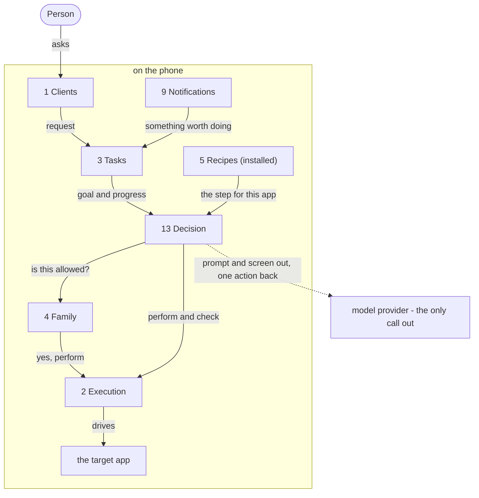
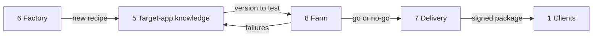
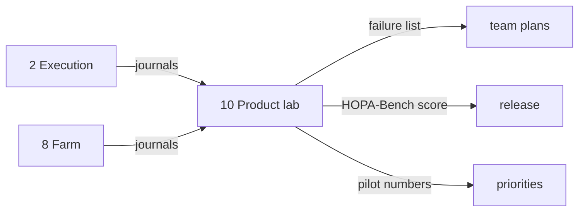

# Team topology: how HOPA splits into parallel teams

Status: **proposal for staffing.** Written 2026-11-14. It turns the additive
tracks in [`expansion-portfolio.md`](../../design/product/expansion-portfolio.md)
into teams with clear ownership, and answers the questions that came up while
reviewing it: what a team owns, where two teams meet, and how many teams to
run at once.

The delivery plan lives in
[`project/plan/android/`](../plan/android/README.md); this page says who builds
what next to it.

## Who uses HOPA

HOPA is used by a **household**: an adult who sets it up, often an older parent
who needs help, and sometimes a child. They share devices and chores, and some
actions need another member's yes. The household is the "family" in brick 4.

## The words in this document

- **client** - our software on the user's device: `apps/android`, `apps/windows`,
  `apps/harmony`.
- **target app** - a third-party app HOPA acts in: a bank, a messenger, a school
  app. "Target-app knowledge" is knowledge of these apps, and a recipe is
  pinned to a target-app build.
- **service** - a part that runs on a computer or server.
- **engine** - the shared code inside the clients (`packages/`).
- **contract** - the written agreement between two teams.
- **recipe** - the instructions for one target app.

## The rule

A team owns **one brick that can break and be fixed on its own**. One owner per
brick, one owner of its data, and one contract at each edge.

**Boundary test:** do these two things change for the same reason?

- Yes -> one team.
- No -> two teams, even if the words sound alike.

## Bricks

Thirteen bricks cover the product. Each one is a candidate team at maximum
parallelism; the next section shows how they merge when there are fewer people.

| # | Brick | What it owns | Effort to a first version |
|---|---|---|---|
| 1 | **Client applications** | The screen and the controls: chat, approvals, notifications, settings, task inbox. Android first, Windows next. | Android is largely done; a new screen is about a week |
| 2 | **Device execution** | Performing one step on a device (system API, share, GUI) and checking the result against the postcondition. | Both paths exist; each new app adds selectors and checks |
| 3 | **Tasks** | What a person asked for: state, next step, resume, handoff to another device. | 8-10 weeks |
| 4 | **Family and approvals** | The household's rules: who is in the family, what each member may do, who confirms an action. | 8-10 weeks |
| 5 | **Target-app knowledge** | The instructions for "how to do X in target app Y": steps, selectors, postconditions, versions. | 6-8 weeks for the format and the first app |
| 6 | **Knowledge factory** | How those instructions are produced: models, consensus, human review. | 6-8 weeks |
| 7 | **Knowledge delivery** | The signed package of recipes, its version, canary rollout, rollback, pinned to a target-app build. | 3-4 weeks |
| 8 | **Verification farm** | Re-running recipes on the device matrix: regression, flake control, failure taxonomy, the go/no-go before a rollout. | 6-8 weeks |
| 9 | **Notification understanding** | Turning a notification into an event or a task: date, owner, urgency. | 2-3 weeks |
| 10 | **Product lab** | What to fix first, pilot numbers, user behaviour, the research thrusts. | ongoing, one researcher |
| 11 | **Platform and integrations** | Device-to-device and device-to-cloud transport, API, pairing. | exists; ongoing |
| 12 | **Architecture and security** | Shared contracts, CI, release, signing, secrets, threat model. | ongoing, half to one person |
| 13 | **Decision (LAIX)** | Chooses the next action: reads the task, the household rules and the known recipes, picks one step, runs the approval gate. LAIX is the current implementation. | 3-5 weeks to port to Kotlin |

Numbers 1-12 keep the values they had; 13 is new. The loop has a decide step, so
it needed a brick: a task says what to do, knowledge says how, and decision picks
the step that runs now.

### How the bricks connect

The bricks run on three different clocks, and mixing them in one picture is what
made the first draft unreadable:

| Picture | Clock | Starts because | Ends when |
|---|---|---|---|
| The request | seconds | a person asks, or a notification arrives | the step ran and was checked |
| The recipe pipeline | days | an app was updated, or a new app is supported | a signed package is on the phone |
| The learning loop | weeks | journals accumulate | a finding changes a team plan or a release |

Numbers match the brick table above. The same brick can appear in more than one
picture: 1 Clients renders the screen in the first, and installs packages in the
second.

**Same clock: the request.** A person asks; seconds later something happened.



Reading it: a task arrives either from the person through the client or from a
notification. Decision picks one step from what knowledge knows about the app. A
step that needs a yes goes through family first and runs only on a yes; a step
that needs no yes runs straight through. A no leaves the task waiting and tells
the person.

The dotted arrow is the only thing that leaves the device: decision sends the
goal, the current screen and the recipes it is choosing between to the model, and
gets one action back. There is no HOPA server in this path. Recipes arrive by
install, which is the next picture. 5 is the brick Target-app knowledge; what
sits on the phone is its installed copy, and the target app is another app on the
same device.

#### Where each box runs

The request path needs **no HOPA server**. The loop, the task, the rules and the
action all live on the device; the only thing fetched is the model's answer.

| Box | Runs on | Needs | With the network off |
|---|---|---|---|
| 1 Clients | the phone (Android), later the PC (Windows) | nothing else | yes: chat, history, settings, records |
| 3 Tasks | the phone's database | nothing else | yes; `services/tasks` is only for resuming on another device |
| 13 Decision | inside the client | a model: a provider over HTTPS, or any OpenAI-compatible server on the LAN | no; Tier 0 (ADR-0019) runs only the fixed commands that need no model |
| 4 Family | the phone | nothing else | yes: profiles are local, there is no account |
| 5 Target-app knowledge | the factory, off the phone; a signed copy is installed on the phone | a package from 7 | the installed copy: yes |
| 2 Execution | the phone (accessibility, system APIs); the PC (UIA) | the target app, running on the same device | yes |
| 9 Notifications | the phone | notification access, granted by the person | yes |
| 7 Delivery | a registry off the phone | network | only while installing; the installed package stays |
| 6, 8, 10 | never on the phone: build and research machines | CI | not applicable |

Two clarifications this table makes:

- **The target app is not "somewhere else".** It is another app on the same
  phone, which is why execution can tap it and read its screen.
- **The model is the only network dependency.** The key is held by the client
  (Android Keystore, Windows DPAPI); no key ships in the repository or in the
  APK.

#### What an action carries, and how execution knows the app

A recipe step is data, and it names its own target, so nothing has to guess.

| Field | Example | Why it is there |
|---|---|---|
| app | `com.example.bank` | execution opens or finds exactly this app |
| screen | "Payments" | checked before acting, so a wrong screen stops the step |
| control | selector, text "Internet" | found again at run time; a moved button fails loudly |
| action | tap | tap, type, swipe, back, share |
| check | the paid screen shows the amount | the postcondition that decides pass or fail |
| timeout | 10 seconds | when to call it failed |

Decision returns the step plus one sentence of why. Execution reads the app id
from the step, brings that app to the front, performs the action through the
accessibility API, waits for the check, and reports pass or fail with a
screenshot and the node tree. The task (3) stores the goal and how far it got,
never a selector, so fixing a recipe does not rewrite anybody's tasks.

#### What decision does inside

- **In:** the goal and progress from the task, the current screen, the last few
  steps and what they returned, the household rules, and the recipes installed on
  the device.
- **The model question:** "given this screen, this goal and these candidate
  steps, which one comes next?" The answer is one action, not a plan.
- **The gate:** read quietly, ask before a sensitive action, always ask before a
  payment.
- **Out, four possibilities only:** perform this step, ask a person, wait, or
  stop and say why.

LAIX is the current implementation of that contract - its policies (when to ask,
when to retry, when to escalate) and its decision record. The Python harness runs
off-device on journals during the pilot; the shipped form is the Kotlin port in
`packages/decision`, because Android and Windows have to agree.

`services/bridge` and `services/relay` are not in this path: they exist so a
phone and a PC can drive each other and share chat. `services/backend` is planned
for a hosted mode where the loop runs on our side; the device keeps the loop
until that exists.

**Slower clock: the recipe pipeline.** No person is involved. An app update or a
new target app starts it.



Reading it: the factory proposes a recipe; knowledge owns it; the farm runs it on
the device matrix and sends failures back; only a version that passes goes to
delivery, which puts a signed package on the phone. This is the whole loop that
keeps a recipe true when an app changes.

**Slowest clock: the learning loop.** Journeys from real runs and from the farm
are read later, in batches, to decide what to do next week.



Reading it: the lab is not a stage in the recipe pipeline; it sits beside it,
reads what the runs produced, and publishes findings that other teams act on. It
does not gate a release and it does not write features.

#### What the Product lab produces

It is research plus measurement, and both have named outputs.

| Output | Form | Used by | How often |
|---|---|---|---|
| Failure list | the steps that failed, with app version and log, ranked | every team's weekly plan | weekly |
| HOPA-Bench score | one number per release, plus the tasks that failed | the release cut | every release |
| Pilot numbers | time saved, steps used, retries, repeats within 7 days | priorities, the family pilot | monthly |
| A research result | a method, a dataset and a report (R1), or a study (R3) | engineering, which then productionises or parks it | per thrust, about six months |

It is not QA: QA runs the release, the lab measures it. It is not product: it
proposes what to fix first, and the owning team decides.

**The two bands.** 11 Platform and 12 Architecture are not phases on any clock,
so they are not drawn as boxes. Platform carries every arrow between the boxes;
architecture sets the contracts, CI, release and signing rules that every box
follows. They wrap all three pictures, which is why the earlier single diagram
put them above and below everything.

### Notifications from target apps

A bank, a messenger or a school app posts a notification. That is the cheapest
place to catch a real task, and the only one that arrives without the person
opening HOPA.

What happens to one, once brick 9 is built:

1. The target app posts it; the phone shows it in the notification stream.
2. The client reads that stream, only for apps the household allowed and only
   with the system permission the person granted. On Android that is
   notification access, and the client has none of it today.
3. 9 turns it into an event: app, sender, what it asks, amount, deadline,
   urgency. Names, amounts and message text are classified on the phone; the raw
   text stays on the phone.
4. Decision 13 asks: task, reminder, or nothing? Noise is dropped, and the drop
   is remembered.
5. A kept event becomes a task in 3; the family rules in 4 decide whether acting
   on it needs a yes.
6. The person's confirm, dismiss or snooze feeds back into the filter in 9.

Today: not built. The Android client shows its own notifications (a run in
progress, a test from settings) and the bridge reads the screen, but nothing
reads the notifications of other apps yet. Two to three weeks: a listener
service, a parser for the first two apps, the on-device redaction, and a settings
screen that lists the apps the household allowed.

Rules: the raw text never leaves the phone, only the classified event does; the
household can revoke an app at any time; a redaction failure counts as a leak.

### Four bricks that need a plain sentence

**7 Delivery. Delivering what, to whom?** Recipes, to phones. Not the APK: app
builds go through CI and the release job. This brick moves the instructions for
one target app from the factory to the devices that hold that app.

A package is one file per target app, containing:

| Part | Contents |
|---|---|
| app identity | package id and the app versions it was built and tested against |
| recipes | for each intent: the steps, selectors, actions, checks and timeouts |
| policy hints | which steps count as sensitive, and which as payment |
| contract version | the schema the client must understand, so an old client refuses instead of misreading |
| metadata | author, date, minimum client version, expiry |
| signature | a hash of everything above, signed with the recipe key; the client ships only the public half |

The **registry** is the index of those packages: which versions exist for each
app, which one is in canary, which is rolled back. A client asks by app id and
its app version, receives a manifest, checks the signature, the contract version,
the app version range and the expiry, and only then writes the recipes into its
local store. An unsigned, expired or mismatched package is refused where it
arrives, not at the first tap.

The work is the format, the signature check in the client, the registry, canary
to a few devices, and rollback in one command. Three to four weeks for the first
version.

Today nothing is delivered this way: recipes are compiled into each client from
`contracts/catalog` at build time (ADR-0018), which is why an app update
currently needs a new build. 7 starts the day a recipe has to change without one.
Without 7, a recipe stays in the factory and costs a release to reach a phone.

**8 Farm. Is it just logging for the lab?** No. It answers one question the other
bricks cannot: *does this recipe still work on version X of the app?* It owns the
device matrix (emulator, Windows machine, one real phone), the go/no-go that
delivery waits for, and the failure list that becomes next week's work. Its
journals also feed the lab, but that is a side effect, not the job. Six to eight
weeks, then continuous.

**12 Architecture. Why is it on top?** Because it is not a step: it has no place
in the request path, which is why it was wrong to draw it beside the person. It
is the layer every box follows - shared contracts, CI, the release cut, signing
keys, the security review. Half to one person, continuously, not a project.

**13 Decision. Where is LAIX?** In 13. It is the step that chooses what to do
next, and LAIX is its current implementation. It is the only brick that reads
both the household rules and the known recipes at the same time, which is why it
sits between the task and the execution.

### Things that look alike

Tasks, knowledge, decision and family are easy to mix up, so here is how each
one works.

**Tasks and knowledge.**

```
TASK       "Mum asks to pay the internet bill"
           who asked - when - who approves - done or not

KNOWLEDGE  "In the bank app: Payments -> Internet -> amount -> confirm"
           which controls - how to tell it worked
```

A task refers to knowledge and keeps the steps out of itself. Knowledge carries
the steps and stays separate from who asked. It is the difference between an
order in a restaurant and the cookbook.

**Decision and knowledge.** Knowledge holds the steps for one app. Decision
chooses which step runs now, for this task and this person, and calls the
approval gate. Knowledge changes when an app changes; decision changes when a
policy or a model changes.

**Tasks and family.** A task answers "what and when"; family answers "who is
allowed to approve it". They change for different reasons, so they are separate
bricks and can be separate teams.

## What "approve" actually means

The family is the household from above. Families approve **permissions for
actions**: who may do what, and who says yes.

| Action | Who asks | Who approves | Example rule |
|---|---|---|---|
| Payment | "pay the internet" | The account holder | Up to 1 000 - self; above - confirmation |
| App install | Child: "install this game" | Parent | A child installs only with a parent |
| Sending a message | "write to my mother as me" | The account owner | Sending as someone else is always confirmed |
| Deletion | "delete all photos from March" | The phone owner | Deletion is confirmed |
| Acting on another phone | Son helps his mother | The mother or a named helper | Remote help only with the owner's consent |
| Changing settings | "turn off notifications" | The device owner | Privacy settings belong to the owner |
| Taking a task | "Mum asks; you do it" | The family member who takes it | A member may take a shared task |

In use:

```
Child:   "Buy me this subscription"
HOPA:    "This is a purchase. A parent has to confirm."
Parent:  [approves]
HOPA:    performs it

Mother (70): "Pay the electricity"
HOPA:        "Payment of 1 240. Confirm?"
Mother:      [confirms]
HOPA:        performs it and shows the receipt
```

The rules belong to the family:

```
Child may:    look, search, set an alarm.
Child may not: pay, delete, message strangers.

Mother may do everything, but confirms her own payments.

The son may help remotely until she turns it off.
```

The family brick therefore owns three things: who is in the family, what each
member may do, and who is asked before an action.

## How many teams

The number is a staffing decision. The table shows which bricks
merge at each size.

| Teams | Composition |
|---|---|
| **13** | One team per brick: maximum parallelism, heavy coordination |
| **7** | 1 - 2+8 - 3+9 - 4 - 5+6+7 - 10+13 - 11, plus 12 as a shared role |
| **5** | 1 - 2+8 - 3+4+9 - 5+6+7 - 10+13, plus 11 and 12 as shared roles |

Merging is allowed when the same two to four people would do both jobs and the
edge between them is trivial. Each brick has exactly one owner.

### Recommended start: seven teams

| Team | Bricks | Mission in one line |
|---|---|---|
| Client applications | 1 | The person gets the result on their own device |
| Execution and verification | 2 + 8 | A step runs on the phone and is proven to have worked |
| Tasks and notifications | 3 + 9 | A request stays findable, and a notification can become a task |
| Family and approvals | 4 | The family decides who may do what |
| Target-app knowledge | 5 + 6 + 7 | A new target app is supported in days and survives updates |
| Algorithms and measurement | 10 + 13 | We know what to fix first, can prove the effect, and the next step is chosen well |
| Platform and integrations | 11 | Devices and services find each other and stay connected |

Shared roles:

| Role | Bricks | Why shared |
|---|---|---|
| Architecture and security | 12 | Contracts, CI and release cut across every team |
| Design | part of 1 | One visual language for every client |

## Where each team lives in the repository

Read each row as **this team owns this folder**. A folder has one owner; another
team may send a pull request into it, but the owner merges it. The names are the
six teams that exist today; the seven-team names sit in brackets where they
split later.

| Owner | Paths they own | What lives there |
|---|---|---|
| **Clients**<br>[Client applications] | `apps/android`, `apps/windows` | The screens, the share target, settings, the APK and the MSI shell |
| | `packages/core`, `packages/data`, `packages/capabilities` | The loop, the stored records, the device capabilities |
| | `apps/harmony` | Frozen client (ADR-0020); maintenance only |
| **Platform and services**<br>[Platform and integrations] | `services/bridge`, `services/relay`, `services/wire` | Transport, pairing, the wire protocol |
| | `services/backend` | Reserved for the server phase; README only until then |
| | `services/brain` | The routing and prompt service. Prompts and target-app knowledge arrive as pull requests from Target-app knowledge |
| | `services/tasks` *(new)*<br>[Tasks and notifications] | Durable tasks, approvals pending, resume. Moves to its own team when the hire lands |
| | `contracts/tasks` *(new)* | The task contract, reviewed with Integration |
| **Target-app knowledge** | `contracts/recipes`, `services/mapping` *(new)* | The recipe contract, the factory, publishing, rollout and rollback |
| **Algorithms and measurement**<br>[Algorithms and measurement] | `packages/decision` *(new, after the LAIX port)* | The decision contract and policies |
| | `services/evals/bench`, `services/evals/baseline` | HOPA-Bench with its task set and results; the reference loop used by the bench |
| **Integration, release and quality**<br>[Verification farm, brick 8] | `.github/workflows` | Every CI job, Android and Windows; the release job that publishes the APK |
| | `services/tools`, `tools/` | Repository checks, scripts, the smoke runner |
| | `docs/project/evidence` | The failure list and the proof for each plan tick |
| **Architecture and contracts** (shared) | `contracts/` (recipes and tasks excepted) | Shared contracts and their review |
| | `docs/design/decisions` | ADRs and the release veto |
| **Every team** | `services/docs`, its own service README | The team that owns the service writes its docs; Architecture edits only the index |

## Edges: what one team hands to another

| From -> To | Artifact | Meaning |
|---|---|---|
| Client -> Tasks | Request | "This is what the person asked" |
| Notification (9) -> Tasks | Event | "This notification is worth a task" |
| Tasks -> Decision | Task state | "This is what to do next" |
| Decision -> Knowledge | Recipe lookup | "Which step performs this?" |
| Knowledge -> Decision | Step | "These are the controls and the check" |
| Decision -> Family | Approval check | "May this member do this now?" |
| Family -> Decision | Yes or no | "Allowed, or ask someone else" |
| Decision -> Execution | Step | "Perform this and check" |
| Factory -> Knowledge | New recipe | "Here is a candidate, reviewed" |
| Knowledge -> Farm | Version to test | "Test this on the matrix" |
| Farm -> Knowledge | Failures | "Version X breaks on this app build" |
| Farm -> Delivery | Go or no-go | "This version passed" |
| Delivery -> Client | Signed package | "Install these recipes" |
| Execution/Farm -> Product lab | Journal entries | "What happened, in how many steps" |
| Product lab -> all | Findings | "Fix this first; these numbers hold" |
| Platform -> all | Transport | "Messages arrive" |
| Architecture -> all | Contracts, CI, release | "The shared rules" |

## Operating rhythm

```
Mon  Plan the week: each team states what it does and whom it waits for
Wed  15-minute sync across edges only
Fri  Demo: five minutes per team, working software only
     Release: the build is green and the APK or service is refreshed
```

Rules that keep parallelism from turning into noise:

1. One owner per folder; a team edits its own folder and asks elsewhere.
2. A shared contract changes only through Architecture and review.
3. A dependency is written down in the team plan.
4. The Product Lab unblocks everyone: it produces methods and numbers.

## Staffing

| Team | People |
|---|---|
| Client applications | 2 developers + 0.5 designer |
| Execution and verification | 2 developers + 1 test engineer |
| Tasks and notifications | 2 developers + 0.5 product |
| Family and approvals | 2 developers |
| Target-app knowledge | 2 developers |
| Algorithms and measurement | 1 engineer on decisions, plus 1 researcher + 0.5 analyst for the lab |
| Platform and integrations | 1 backend developer |
| Architecture and security | 1 engineer (can be 0.5 + 0.5 security reviewer) |

About 13 full-time equivalents at seven teams. At five teams the same work fits
in about 10: Tasks and family merge, and the two shared roles stay shared.

## People and ownership (2026-11)

Eight people today, so the shape is **six teams**; the seven-team table above is
the shape when the two open hires land. Nothing moves when that happens: Tasks
has its own service already, and the farm is a folder.

| Team | Lead | Second | Folders | What they ship |
|---|---|---|---|---|
| **Clients** | Michael | Chaya | `apps/android`, `apps/windows`, `apps/harmony` (frozen), `packages/core`, `packages/data`, `packages/capabilities` | Screens and flows, the share target, settings, visual parity with Harmony; the APK and the MSI shell |
| **Platform and services** | Amir | Batya | `services/backend`, `services/bridge`, `services/relay`, `services/wire`, `services/brain` (the service); `services/tasks` until the hire | The pairing code, tokens, the phone-to-PC tunnel, the wire protocol, the brain service |
| **Target-app knowledge** | Nizzan | Shira | `contracts/recipes`, `services/mapping` | A recipe per target app: steps, selectors, the check that it worked, the app version it is pinned to |
| **Algorithms and measurement** | Sefi | - | `packages/decision` (after the LAIX port), `services/evals/bench`, `services/evals/baseline` | The HOPA-Bench task set and its score per release; four numbers read from journals |
| **Integration, release and quality** | Yoni | - | `.github/workflows`, `docs/project/evidence`, the release checklist | Green CI, the release APK and MSI, the failure list, the signing and permission review |
| **Architecture and contracts** (shared role) | Michael + Amir + Yoni | - | `contracts/` | Contract text, seam reviews, release veto |
| **Design** (shared role) | open | - | theme files in `packages/` | One visual language for every client |

### The words that were doing too much work

Each of these now names a file, a number or a check, so a new person can find
it on day one.

| Word | What it means here | Where to look |
|---|---|---|
| **benchmark** | HOPA-Bench: 20 fixed tasks (Settings, Clock, Calendar, Browser, Notes, Contacts, Messages, Music, Files) written as YAML. Each task names a success check the device itself must show. One run gives one number: how many of the 20 passed. | `services/evals/bench/tasks`, results in `services/evals/bench/results` |
| **metric** | One number read from the journals of real runs: time to finish, steps used, retries per step, and whether the person asked for the same thing again within 7 days. | `services/evals`, journal records from `packages/data` |
| **the gaps** | The failure list: every step that did not run or whose check said no, with the target-app version and the log. It is the first input to each week's planning. | `docs/project/evidence`, ticked in `docs/project/plan` |
| **security** | Four concrete things: APK and recipe signing keys; keystore files and `keystore.properties` stay out of git; secrets on Windows live in Credential Manager, not in settings JSON; the bridge and relay are reviewed for what they expose. | `apps/android` signing, `apps/windows` settings, `services/bridge` |
| **farm** | The devices that run the benchmark and the app matrix: the Android emulator, the Windows machine, and one real phone when one is available. | `.github/workflows`, the Windows `--matrix-check` |

Why six teams: the **Tasks** brick lives inside Platform until the hire
(Amir + Batya), the **farm** lives inside Integration (Yoni), and **decision**
lives inside Algorithms (Sefi). All three are already separate folders and
contracts, so splitting them later is a staffing change.

### Who to ask for a path

The table above says which **team** owns a folder. This one says which **person**
to ask, and is the one to use when a pull request is stuck.

| Path | Person |
|---|---|
| `apps/android`, `apps/windows`, `apps/harmony` | Michael (Chaya) |
| `packages/core`, `packages/data`, `packages/capabilities` | Michael |
| `packages/decision` (new, from LAIX) | Sefi (algorithms) + Michael (contract and Kotlin port) |
| `services/backend`, `services/bridge`, `services/relay`, `services/wire` | Amir (Batya) |
| `services/brain` | Amir owns the service; knowledge and prompts arrive from Nizzan |
| `services/tasks` (new) | Amir (Batya) |
| `contracts/tasks` | Amir + Yoni |
| `contracts/recipes`, `services/mapping` (new) | Nizzan (Shira) |
| `services/evals/bench`, `services/evals/baseline` | Sefi |
| `.github/workflows`, `services/tools`, `tools/`, `docs/project/evidence` | Yoni |
| `contracts/*` (other than tasks and recipes) | Michael + Amir review |
| `docs/design/decisions` | Michael + Amir + Yoni |
| `services/docs` | the owner of each service; Architecture edits the index |

### Where the seconds go

- **Batya -> Amir.** Backend is her strength and Amir carries four services; the
  second is needed on day one.
- **Shira -> Nizzan.** Recommended: app analysis is the newest and least known
  area, while the clients already have Michael and a working process. If Shira
  is stronger in UI, she and Chaya swap.
- **Chaya -> Michael**, with one day a week with Yoni on the farm and CI. Two
  clients plus visual parity is more than one person, and she covers peaks.

### LAIX

- **Product and algorithms:** Sefi (new versions, policies, benchmarks). Michael
  wrote LAIX and keeps the contract and compatibility.
- **Inside HOPA:** a pilot in Algorithms first, on HOPA's own journals (two to
  three weeks), then a decision on a Kotlin port in `packages/decision`
  (Michael + Sefi). The product path is the Kotlin port in `packages/decision`,
  so behaviour matches on Android and Windows; a Python runtime beside the loop
  would add a second behaviour to keep in step.
- **Where it runs:** the decision contract and policies ship inside the client
  (Kotlin port). The Python harness stays in research: it reads journals
  off-device and is not a dependency of the APK or the MSI.
- If LAIX is also a product of its own, it needs a named owner; otherwise it
  dissolves into HOPA.

### Load check (honest)

| Person | Risk | Mitigation |
|---|---|---|
| Michael | clients + LAIX + architecture is too much | Chaya in clients; LAIX algorithms to Sefi; contracts reviewed with Amir |
| Amir | four services plus tasks | Batya; Yoni takes CI and release |
| Nizzan | a new area with no second | Shira; one system app as the first case |
| Sefi | "algorithms everywhere" is too broad | scope: the decision contract, HOPA-Bench, the four journal numbers |
| Yoni | many things have no other owner | charter: CI, release, failure list, signing, farm |
| - | no product or designer | reserve 0.5 product and 0.5 design, or parity and priorities drift |

### First 90 days

| Who | Finishes |
|---|---|
| Michael + Chaya | the Windows gates (W3-W5) and the Android gates; Windows visual parity (W6) |
| Amir + Batya | `contracts/tasks` and the `services/tasks` skeleton; token rotation; bridge and relay |
| Nizzan + Shira | the first system app: analysis -> `contracts/recipes` -> one recipe end to end |
| Sefi | the LAIX pilot on HOPA episodes; the decision contract; a HOPA-Bench score for the current release; the four journal numbers |
| Yoni | Windows and Android CI jobs, the farm on the runners, the release checklist, the failure list, the signing review |

## Launch waves

```
Weeks 1-2   PREPARATION, all together
            - Architecture: the two shared contracts (task, recipe)
            - Leads: folders, plans, rhythm
            - No feature code yet

Week 3      ALL TEAMS START
            Client: finish the Android gates
            Tasks: skeleton of the task service
            Knowledge: one system app end to end
            Lab: measurement protocol

Weeks 3-12  Parallel work, weekly demo

Week 12     FIRST END-TO-END CHECK
            one request travels person -> phone -> done

Week 24     REVIEW
            keep, park or expand each initiative
```

## What success looks like

1. One request runs end to end: person, phone, result.
2. No team sits idle waiting for another without saying so.
3. Every Friday the build is green and somebody can show it.

## Open decisions

- Is the task service a new `services/tasks`, or part of the bridge? The
  recommendation is a separate service: the bridge stays transport, the client
  keeps the loop and the gate (ADR-0016).
- Which target app gets the first recipe: a system app, a school app, or a ride-hailing
  app? A system app is the hermetic case; the ride-hailing app is the
  cross-device demo.
- Is the family local-first (profiles plus optional sync) or account-based from
  day one? Local-first matches the no-account non-goal (ADR-0011).
- Does the Product lab start with R1 (recipes that survive app updates) alone,
  or split 60/40 with R2/R3? R3 is attractive because the approval interface
  already exists.
- Where does the test farm run: the existing CI runners, or a dedicated machine?
