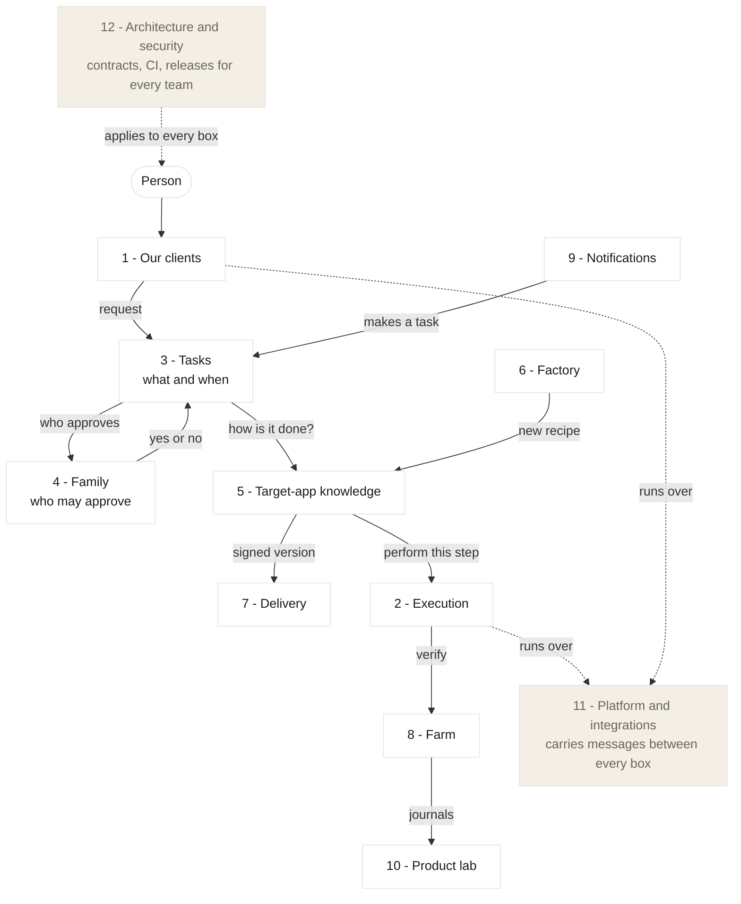

# Team topology: how HOPA splits into parallel teams

Status: **proposal for staffing.** Written 2026-11-14. It turns the additive
tracks in [`expansion-portfolio.md`](../../design/product/expansion-portfolio.md)
into teams with clear ownership, and answers the questions that came up while
reviewing it: what a team owns, where two teams meet, and how many teams to
run at once.

The delivery plan lives in
[`project/plan/android/`](../plan/android/README.md); this page says who builds
what next to it.

## Who uses HOPA

HOPA is used by a **household**: an adult who sets it up, often an older parent
who needs help, and sometimes a child. They share devices and chores, and some
actions need another member's yes. The household is the "family" in brick 4.

## The words in this document

- **client** - our software on the user's device: `apps/android`, `apps/windows`,
  `apps/harmony`.
- **target app** - a third-party app HOPA acts in: a bank, a messenger, a school
  app. "Target-app knowledge" is knowledge of these apps, and a recipe is
  pinned to a target-app build.
- **service** - a part that runs on a computer or server.
- **engine** - the shared code inside the clients (`packages/`).
- **contract** - the written agreement between two teams.
- **recipe** - the instructions for one target app.

## The rule

A team owns **one brick that can break and be fixed on its own**. One owner per
brick, one owner of its data, and one contract at each edge.

**Boundary test:** do these two things change for the same reason?

- Yes -> one team.
- No -> two teams, even if the words sound alike.

## Bricks

Twelve bricks cover the product. Each one is a candidate team at maximum
parallelism; the next section shows how they merge when there are fewer people.

| # | Brick | What it owns |
|---|---|---|
| 1 | **Client applications** | The screen and the controls: chat, approvals, notifications, settings, task inbox. Android now, Windows next. |
| 2 | **Device execution** | Performing one step on a device (system API, share, GUI) and verifying the result. |
| 3 | **Tasks** | What a person asked for: state, next step, resume, handoff to another device. |
| 4 | **Family and approvals** | The household's rules: who is in the family, what each member may do, who confirms an action. |
| 5 | **Target-app knowledge** | The instructions for "how to do X in target app Y": steps, selectors, postconditions, versions. |
| 6 | **Knowledge factory** | How those instructions are produced: models, consensus, human review. |
| 7 | **Knowledge delivery** | Signed recipe versions, canary rollout, rollback, pinned to a target-app build. |
| 8 | **Verification farm** | Phones and emulators, regression, flake control, failure taxonomy. |
| 9 | **Notification understanding** | Turning a notification into an event or a task: date, owner, urgency. |
| 10 | **Product lab** | What to fix first, pilot numbers, user behaviour, the research thrusts. |
| 11 | **Platform and integrations** | Device-to-device and device-to-cloud transport, API, pairing. |
| 12 | **Architecture and security** | Shared contracts, CI, release, approval policy, secrets, threat model. |

### How the bricks connect



### Three things that look alike

Tasks, knowledge and family are easy to mix up, so here is how each one works.

**Tasks and knowledge.**

```
TASK       "Mum asks to pay the internet bill"
           who asked - when - who approves - done or not

KNOWLEDGE  "In the bank app: Payments -> Internet -> amount -> confirm"
           which controls - how to tell it worked
```

A task refers to knowledge and keeps the steps out of itself. Knowledge carries
the steps and stays separate from who asked. It is the difference between an
order in a restaurant and the cookbook.

**Tasks and family.** A task answers "what and when"; family answers "who is
allowed to approve it". They change for different reasons, so they are separate
bricks and can be separate teams.

## What "approve" actually means

The family is the household from above. Families approve **permissions for
actions**: who may do what, and who says yes.

| Action | Who asks | Who approves | Example rule |
|---|---|---|---|
| Payment | "pay the internet" | The account holder | Up to 1 000 - self; above - confirmation |
| App install | Child: "install this game" | Parent | A child installs only with a parent |
| Sending a message | "write to my mother as me" | The account owner | Sending as someone else is always confirmed |
| Deletion | "delete all photos from March" | The phone owner | Deletion is confirmed |
| Acting on another phone | Son helps his mother | The mother or a named helper | Remote help only with the owner's consent |
| Changing settings | "turn off notifications" | The device owner | Privacy settings belong to the owner |
| Taking a task | "Mum asks; you do it" | The family member who takes it | A member may take a shared task |

In use:

```
Child:   "Buy me this subscription"
HOPA:    "This is a purchase. A parent has to confirm."
Parent:  [approves]
HOPA:    performs it

Mother (70): "Pay the electricity"
HOPA:        "Payment of 1 240. Confirm?"
Mother:      [confirms]
HOPA:        performs it and shows the receipt
```

The rules belong to the family:

```
Child may:    look, search, set an alarm.
Child may not: pay, delete, message strangers.

Mother may do everything, but confirms her own payments.

The son may help remotely until she turns it off.
```

The family brick therefore owns three things: who is in the family, what each
member may do, and who is asked before an action.

## How many teams

The number is a staffing decision. The table shows which bricks
merge at each size.

| Teams | Composition |
|---|---|
| **12** | One team per brick: maximum parallelism, heavy coordination |
| **7** | 1 - 2+8 - 3+9 - 4 - 5+6+7 - 10 - 11, plus 12 as a shared role |
| **5** | 1 - 2+8 - 3+4+9 - 5+6+7 - 10, plus 11 and 12 as shared roles |

Merging is allowed when the same two to four people would do both jobs and the
edge between them is trivial. Each brick has exactly one owner.

### Recommended start: seven teams

| Team | Bricks | Mission in one line |
|---|---|---|
| Client applications | 1 | The person gets the result on their own device |
| Execution and verification | 2 + 8 | A step runs on the phone and is proven to have worked |
| Tasks and notifications | 3 + 9 | A request stays findable, and a notification can become a task |
| Family and approvals | 4 | The family decides who may do what |
| Target-app knowledge | 5 + 6 + 7 | A new target app is supported in days and survives updates |
| Product lab | 10 | We know what to fix first and can prove the effect |
| Platform and integrations | 11 | Devices and services find each other and stay connected |

Shared roles:

| Role | Bricks | Why shared |
|---|---|---|
| Architecture and security | 12 | Contracts, CI and release cut across every team |
| Design | part of 1 | One visual language for every client |

## Where each team lives in the repository

Read each row as **this team owns this folder**. A folder has one owner; another
team may send a pull request into it, but the owner merges it. The names are the
six teams that exist today; the seven-team names sit in brackets where they
split later.

| Owner | Paths they own | What lives there |
|---|---|---|
| **Clients**<br>[Client applications] | `apps/android`, `apps/windows` | The screens, the share target, settings, the APK and the MSI shell |
| | `packages/core`, `packages/data`, `packages/capabilities` | The loop, the stored records, the device capabilities |
| | `apps/harmony` | Frozen client (ADR-0020); maintenance only |
| **Platform and services**<br>[Platform and integrations] | `services/bridge`, `services/relay`, `services/wire` | Transport, pairing, the wire protocol |
| | `services/backend` | Reserved for the server phase; README only until then |
| | `services/brain` | The routing and prompt service. Prompts and target-app knowledge arrive as pull requests from Target-app knowledge |
| | `services/tasks` *(new)*<br>[Tasks and notifications] | Durable tasks, approvals pending, resume. Moves to its own team when the hire lands |
| | `contracts/tasks` *(new)* | The task contract, reviewed with Integration |
| **Target-app knowledge** | `contracts/recipes`, `services/mapping` *(new)* | The recipe contract, the factory, publishing, rollout and rollback |
| **Algorithms and measurement**<br>[Product lab] | `packages/decision` *(new, after the LAIX port)* | The decision contract and policies |
| | `services/evals/bench`, `services/evals/baseline` | HOPA-Bench with its task set and results; the reference loop used by the bench |
| **Integration, release and quality**<br>[Verification farm, brick 8] | `.github/workflows` | Every CI job, Android and Windows; the release job that publishes the APK |
| | `services/tools`, `tools/` | Repository checks, scripts, the smoke runner |
| | `docs/project/evidence` | The failure list and the proof for each plan tick |
| **Architecture and contracts** (shared) | `contracts/` (recipes and tasks excepted) | Shared contracts and their review |
| | `docs/design/decisions` | ADRs and the release veto |
| **Every team** | `services/docs`, its own service README | The team that owns the service writes its docs; Architecture edits only the index |

## Edges: what one team hands to another

| From -> To | Artifact | Meaning |
|---|---|---|
| Client -> Tasks | Request | "This is what the person asked" |
| Tasks -> Target-app knowledge | Recipe request | "Which recipe performs this step?" |
| Tasks -> Execution | Step | "Perform this and verify" |
| Family -> Tasks | Approval rule | "This action needs X's confirmation" |
| Target-app knowledge -> Client | Signed recipe | "These are the steps, this version" |
| Factory -> Target-app knowledge | New recipe | "Here is a candidate, reviewed" |
| Target-app knowledge -> Delivery | Release | "Publish this version" |
| Execution/Farm -> Product lab | Journal entries | "What happened, in how many steps" |
| Product lab -> all | Findings | "Fix this first; these numbers hold" |
| Platform -> all | Transport | "Messages arrive" |
| Architecture -> all | Contracts, CI, release | "The shared rules" |

## Operating rhythm

```
Mon  Plan the week: each team states what it does and whom it waits for
Wed  15-minute sync across edges only
Fri  Demo: five minutes per team, working software only
     Release: the build is green and the APK or service is refreshed
```

Rules that keep parallelism from turning into noise:

1. One owner per folder; a team edits its own folder and asks elsewhere.
2. A shared contract changes only through Architecture and review.
3. A dependency is written down in the team plan.
4. The Product Lab unblocks everyone: it produces methods and numbers.

## Staffing

| Team | People |
|---|---|
| Client applications | 2 developers + 0.5 designer |
| Execution and verification | 2 developers + 1 test engineer |
| Tasks and notifications | 2 developers + 0.5 product |
| Family and approvals | 2 developers |
| Target-app knowledge | 2 developers |
| Product lab | 1 researcher + 0.5 analyst |
| Platform and integrations | 1 backend developer |
| Architecture and security | 1 engineer (can be 0.5 + 0.5 security reviewer) |

About 12 full-time equivalents at seven teams. At five teams the same work fits
in about 9: Tasks and family merge, and the two shared roles stay shared.

## People and ownership (2026-11)

Eight people today, so the shape is **six teams**; the seven-team table above is
the shape when the two open hires land. Nothing moves when that happens: Tasks
has its own service already, and the farm is a folder.

| Team | Lead | Second | Folders | What they ship |
|---|---|---|---|---|
| **Clients** | Michael | Chaya | `apps/android`, `apps/windows`, `apps/harmony` (frozen), `packages/core`, `packages/data`, `packages/capabilities` | Screens and flows, the share target, settings, visual parity with Harmony; the APK and the MSI shell |
| **Platform and services** | Amir | Batya | `services/backend`, `services/bridge`, `services/relay`, `services/wire`, `services/brain` (the service); `services/tasks` until the hire | The pairing code, tokens, the phone-to-PC tunnel, the wire protocol, the brain service |
| **Target-app knowledge** | Nizzan | Shira | `contracts/recipes`, `services/mapping` | A recipe per target app: steps, selectors, the check that it worked, the app version it is pinned to |
| **Algorithms and measurement** | Sefi | - | `packages/decision` (after the LAIX port), `services/evals/bench`, `services/evals/baseline` | The HOPA-Bench task set and its score per release; four numbers read from journals |
| **Integration, release and quality** | Yoni | - | `.github/workflows`, `docs/project/evidence`, the release checklist | Green CI, the release APK and MSI, the failure list, the signing and permission review |
| **Architecture and contracts** (shared role) | Michael + Amir + Yoni | - | `contracts/` | Contract text, seam reviews, release veto |
| **Design** (shared role) | open | - | theme files in `packages/` | One visual language for every client |

### The words that were doing too much work

Each of these now names a file, a number or a check, so a new person can find
it on day one.

| Word | What it means here | Where to look |
|---|---|---|
| **benchmark** | HOPA-Bench: 20 fixed tasks (Settings, Clock, Calendar, Browser, Notes, Contacts, Messages, Music, Files) written as YAML. Each task names a success check the device itself must show. One run gives one number: how many of the 20 passed. | `services/evals/bench/tasks`, results in `services/evals/bench/results` |
| **metric** | One number read from the journals of real runs: time to finish, steps used, retries per step, and whether the person asked for the same thing again within 7 days. | `services/evals`, journal records from `packages/data` |
| **the gaps** | The failure list: every step that did not run or whose check said no, with the target-app version and the log. It is the first input to each week's planning. | `docs/project/evidence`, ticked in `docs/project/plan` |
| **security** | Four concrete things: APK and recipe signing keys; keystore files and `keystore.properties` stay out of git; secrets on Windows live in Credential Manager, not in settings JSON; the bridge and relay are reviewed for what they expose. | `apps/android` signing, `apps/windows` settings, `services/bridge` |
| **farm** | The devices that run the benchmark and the app matrix: the Android emulator, the Windows machine, and one real phone when one is available. | `.github/workflows`, the Windows `--matrix-check` |

Why six teams: the **Tasks** brick lives inside Platform until the hire
(Amir + Batya), and the **farm** lives inside Integration (Yoni). Both are
already separate folders and contracts, so splitting them later is a staffing change.

### Who to ask for a path

The table above says which **team** owns a folder. This one says which **person**
to ask, and is the one to use when a pull request is stuck.

| Path | Person |
|---|---|
| `apps/android`, `apps/windows`, `apps/harmony` | Michael (Chaya) |
| `packages/core`, `packages/data`, `packages/capabilities` | Michael |
| `packages/decision` (new, from LAIX) | Sefi (algorithms) + Michael (contract and Kotlin port) |
| `services/backend`, `services/bridge`, `services/relay`, `services/wire` | Amir (Batya) |
| `services/brain` | Amir owns the service; knowledge and prompts arrive from Nizzan |
| `services/tasks` (new) | Amir (Batya) |
| `contracts/tasks` | Amir + Yoni |
| `contracts/recipes`, `services/mapping` (new) | Nizzan (Shira) |
| `services/evals/bench`, `services/evals/baseline` | Sefi |
| `.github/workflows`, `services/tools`, `tools/`, `docs/project/evidence` | Yoni |
| `contracts/*` (other than tasks and recipes) | Michael + Amir review |
| `docs/design/decisions` | Michael + Amir + Yoni |
| `services/docs` | the owner of each service; Architecture edits the index |

### Where the seconds go

- **Batya -> Amir.** Backend is her strength and Amir carries four services; the
  second is needed on day one.
- **Shira -> Nizzan.** Recommended: app analysis is the newest and least known
  area, while the clients already have Michael and a working process. If Shira
  is stronger in UI, she and Chaya swap.
- **Chaya -> Michael**, with one day a week with Yoni on the farm and CI. Two
  clients plus visual parity is more than one person, and she covers peaks.

### LAIX

- **Product and algorithms:** Sefi (new versions, policies, benchmarks). Michael
  wrote LAIX and keeps the contract and compatibility.
- **Inside HOPA:** a pilot in Algorithms first, on HOPA's own journals (two to
  three weeks), then a decision on a Kotlin port in `packages/decision`
  (Michael + Sefi). The product path is the Kotlin port in `packages/decision`,
  so behaviour matches on Android and Windows; a Python runtime beside the loop
  would add a second behaviour to keep in step.
- If LAIX is also a product of its own, it needs a named owner; otherwise it
  dissolves into HOPA.

### Load check (honest)

| Person | Risk | Mitigation |
|---|---|---|
| Michael | clients + LAIX + architecture is too much | Chaya in clients; LAIX algorithms to Sefi; contracts reviewed with Amir |
| Amir | four services plus tasks | Batya; Yoni takes CI and release |
| Nizzan | a new area with no second | Shira; one system app as the first case |
| Sefi | "algorithms everywhere" is too broad | scope: the decision contract, HOPA-Bench, the four journal numbers |
| Yoni | many things have no other owner | charter: CI, release, failure list, signing, farm |
| - | no product or designer | reserve 0.5 product and 0.5 design, or parity and priorities drift |

### First 90 days

| Who | Finishes |
|---|---|
| Michael + Chaya | the Windows gates (W3-W5) and the Android gates; Windows visual parity (W6) |
| Amir + Batya | `contracts/tasks` and the `services/tasks` skeleton; token rotation; bridge and relay |
| Nizzan + Shira | the first system app: analysis -> `contracts/recipes` -> one recipe end to end |
| Sefi | the LAIX pilot on HOPA episodes; the decision contract; a HOPA-Bench score for the current release; the four journal numbers |
| Yoni | Windows and Android CI jobs, the farm on the runners, the release checklist, the failure list, the signing review |

## Launch waves

```
Weeks 1-2   PREPARATION, all together
            - Architecture: the two shared contracts (task, recipe)
            - Leads: folders, plans, rhythm
            - No feature code yet

Week 3      ALL TEAMS START
            Client: finish the Android gates
            Tasks: skeleton of the task service
            Knowledge: one system app end to end
            Lab: measurement protocol

Weeks 3-12  Parallel work, weekly demo

Week 12     FIRST END-TO-END CHECK
            one request travels person -> phone -> done

Week 24     REVIEW
            keep, park or expand each initiative
```

## What success looks like

1. One request runs end to end: person, phone, result.
2. No team sits idle waiting for another without saying so.
3. Every Friday the build is green and somebody can show it.

## Open decisions

- Is the task service a new `services/tasks`, or part of the bridge? The
  recommendation is a separate service: the bridge stays transport, the client
  keeps the loop and the gate (ADR-0016).
- Which target app gets the first recipe: a system app, a school app, or a ride-hailing
  app? A system app is the hermetic case; the ride-hailing app is the
  cross-device demo.
- Is the family local-first (profiles plus optional sync) or account-based from
  day one? Local-first matches the no-account non-goal (ADR-0011).
- Does the Product lab start with R1 (recipes that survive app updates) alone,
  or split 60/40 with R2/R3? R3 is attractive because the approval interface
  already exists.
- Where does the test farm run: the existing CI runners, or a dedicated machine?
